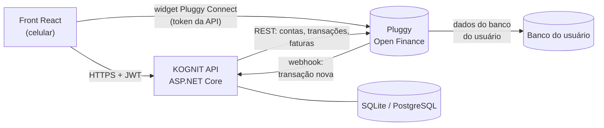
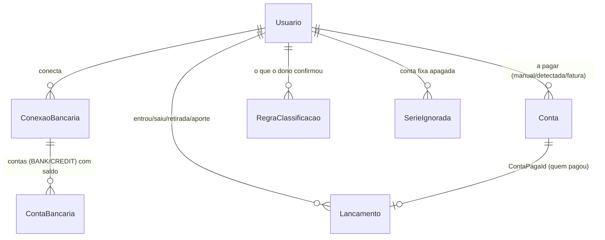

# Como a KOGNIT API foi programada

Guia para entender o código: camadas, caminho de cada requisição, onde fica cada regra e como estender. As razões de cada escolha estão em [`DECISOES.md`](DECISOES.md).

## 1. Visão geral



## 2. Camadas e pastas

```
Kognit.slnx
├── src/Kognit.Dominio/          ← regras de negócio PURAS (sem banco, sem HTTP)
│   ├── Modelos/Modelos.cs            Lancamento, Conta, RegraClassificacao, TransacaoBancaria, EstadoFinanceiro
│   ├── Regras/Texto.cs               limpeza das descrições, chave do favorecido, meio de pagamento, R$
│   ├── Regras/Classificador.cs       o que é cada transação (venda, gasto+categoria, retirada, aporte)
│   ├── Regras/ProcessadorExtrato.cs  importar sem duplicar, contas fixas, baixa automática, "Confira"
│   ├── Regras/Financas.cs            saldo, médias, previsão de 30 dias, semáforo, alertas
│   ├── Regras/LinhaDigitavel.cs      valor e vencimento a partir da linha digitável do boleto
│   └── Demo/ExtratoDemo.cs           extrato simulado (pet shop) + modo apresentação
│
├── src/Kognit.Api/              ← entrega HTTP, persistência e integrações
│   ├── Program.cs                    monta tudo: banco, JWT, CORS, Pluggy, segundo plano, OpenAPI
│   ├── Controllers/                  rotas (uma classe por recurso)
│   ├── Contratos/Contratos.cs        JSON de entrada e saída (DTOs) — o "contrato" com o React
│   ├── Infra/                        entidades do banco, AppDbContext, BancoDeDados (SQLite/Postgres), Migracoes/, RepositorioEstado, trava, relógio
│   ├── Pluggy/                       cliente HTTP da Pluggy, modelos REST, normalizador
│   ├── Bancos/                       IProvedorBancario: ProvedorPluggy (real) e ProvedorDemo
│   └── Servicos/                     Sincronizador, fila + trabalhadores em segundo plano, token JWT
│
└── tests/Kognit.Tests/
    ├── Dominio/                      testes das regras (rápidos, sem servidor)
    └── Api/                          API em memória + Pluggy falsa (PluggyFalsa.cs)
```

**Regra de dependência:** `Api → Dominio`, nunca o contrário. O Domínio não sabe que existe Pluggy, HTTP ou banco de dados.

## 3. Modelo de dados



| Entidade | Para quê | Campos-chave |
|---|---|---|
| `Lancamento` | cada movimentação | `IdExterno` (id no banco; único por usuário), `Tipo`, `Categoria`, `Meio`, `Chave` (favorecido), `Motivo`, `Revisar`, `ContaPagaId` / `Serie` |
| `Conta` | conta/boleto a pagar | `Origem` (Manual, Detectada, FaturaCartao), `Vencimento`, `Recorrente`, `Paga`, `PagaPeloBanco`, `Serie`, `Chave`, `IdExterno` |
| `ConexaoBancaria` | banco conectado | `Provedor` (Pluggy/Demo), `ItemId` (único), `Status`, `Mensagem`, `UltimaSincronizacao` |
| `ContaBancaria` | conta dentro do banco | `Tipo` (BANK/CREDIT), `Saldo` informado pelo banco |
| `RegraClassificacao` | "este favorecido é pessoal / é Fornecedor" | `Chave` + `Tipo` + `Categoria` |

## 4. O caminho de cada fluxo

### 4.1 Conectar o banco

```mermaid
sequenceDiagram
    participant R as React
    participant A as API
    participant P as Pluggy
    R->>A: POST /api/conexoes/token
    A->>P: POST /connect_token {options: {clientUserId: usuário, webhookUrl}}
    P-->>A: accessToken
    A-->>R: {accessToken, incluirSandbox}
    R->>P: abre o widget Pluggy Connect; o usuário escolhe o banco e autoriza
    P-->>R: onSuccess({ item })
    R->>A: POST /api/conexoes {itemId: item.id}
    A->>P: GET /items/{id}
    Note over A: confere item.clientUserId == usuário (senão 403)
    A->>A: Sincronizador (seção 4.2)
    A-->>R: 201 {status: "conectado", saldoContas, contas}
```

### 4.2 Sincronizar (`Servicos/Sincronizador.cs`)

1. Trava o usuário (`TravaPorUsuario`).
2. `IProvedorBancario.BuscarAsync`:
   - **Pluggy:** item → contas → transações da conta `BANK` (cursor) → fatura do cartão `CREDIT`.
   - **Demo:** extrato simulado.
3. Item ainda `UPDATING`: marca "atualizando" e a fila tenta de novo em 5 s.
4. Erro de login: marca "erro" com a mensagem para o usuário reconectar.
5. Atualiza os **saldos** das contas bancárias.
6. Carrega o estado do usuário (`RepositorioEstado`) e chama o Domínio:
   - `ProcessadorExtrato.Importar`: classifica cada transação nova (`Classificador`), detecta contas fixas e concilia;
   - faturas do cartão viram/atualizam `Conta` (`Origem = FaturaCartao`);
   - `ConciliarContas` de novo (para a fatura recém-criada).
7. Salva as diferenças, marca "conectado" e grava `UltimaSincronizacao`.

### 4.3 Transação nova (webhook)

```mermaid
sequenceDiagram
    participant B as Banco
    participant P as Pluggy
    participant A as API
    participant F as Fila (segundo plano)
    B->>P: Pix recebido
    P->>A: POST /api/webhooks/pluggy?segredo=… {event: "transactions/created", itemId}
    A->>A: confere segredo; acha a conexão pelo itemId
    A->>F: Enfileirar(conexão)
    A-->>P: 200 (na hora)
    F->>A: Sincronizador.SincronizarAsync (busca os dados na Pluggy de novo)
    Note over A: próximo GET /api/painel ou /api/extrato já mostra o Pix
```

### 4.4 Uma tela (ex.: Início)

`GET /api/painel` → `PainelController`:
1. Pede sincronização em segundo plano se a última tem mais de 1 h.
2. Carrega o estado.
3. Chama `Financas.SaldoAtual`, `CalcularSemaforo`, `CalcularAlertas` e `CalcularTotais`.
4. Monta o `PainelResponse`.

As outras telas seguem o mesmo padrão: **carregar estado → função do Domínio → DTO**.

## 5. Onde mudar cada regra

| Quero mudar… | Arquivo |
|---|---|
| palavras que reconhecem uma categoria (ex.: nova concessionária de energia) | `Dominio/Regras/Classificador.cs` → `RegrasPalavras` |
| o que "parece pessoal" | `Classificador.cs` → `TermosPessoais` |
| critério de conta fixa (meses, ±20%, dia) | `ProcessadorExtrato.DetectarContasRecorrentes` |
| janela da baixa automática | `ProcessadorExtrato.ConciliarContas` |
| fórmula da previsão / regras do semáforo / textos dos alertas | `Dominio/Regras/Financas.cs` |
| quantos dias buscar, intervalo da rotina | `appsettings.json` → `Sincronizacao` |
| campos que o React recebe | `Api/Contratos/Contratos.cs` |

## 6. Como estender

**Outro agregador (ex.: Belvo):**
1. Criar `BelvoCliente`.
2. Criar `ProvedorBelvo : IProvedorBancario`, que converte as transações para `TransacaoBancaria`.
3. Acrescentar `Belvo` em `ProvedorBancario` e registrar em `Program.cs`.

O Domínio não muda.

**Banco de dados:** já funciona com SQLite e PostgreSQL/Supabase (`Infra/BancoDeDados.cs`). Ao mudar uma entidade, crie a migração:

```bash
dotnet ef migrations add NomeDaMudanca -p src/Kognit.Api -o Infra/Migracoes
```

No PostgreSQL as tabelas ficam no schema `kognit` (ver `DECISOES.md`, H2).

**Push no celular:** no fim de `Sincronizador.SincronizarAsync`, quando houver `novos`, enviar Web Push para as inscrições do usuário (nova tabela `InscricaoPush`).

## 7. Testes

```bash
dotnet test
```

- **`tests/Dominio`:** chamam as funções do Domínio com listas montadas no próprio teste. Rodam em milissegundos.
- **`tests/Api`:** a `ApiFactory` sobe a API de verdade em memória, com:
  - um arquivo SQLite temporário por execução;
  - configuração de teste (chave JWT, segredo do webhook);
  - a **`PluggyFalsa`** no lugar da rede, que responde `auth`, `connect_token`, `items`, `accounts`, `v2/transactions` (em 2 páginas, para testar o cursor) e `bills` no formato do SDK oficial.

  Os testes fazem requisições HTTP como o React faria.
